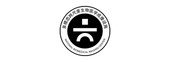

<p align="center">
  <a href="https://freedomintelligence.github.io/OmniDentBench/"></a>
</p>

<h1 align="center">OmniDentBench</h1>

<p align="center"><strong>A multilingual, multimodal benchmark for dental AI reasoning</strong></p>

<p align="center">
  <a href="https://freedomintelligence.github.io/OmniDentBench/">Project website</a> ·
  <a href="https://freedomintelligence.github.io/OmniDentBench/zh.html">中文主页</a> ·
  <a href="#quick-start">Quick start</a> ·
  <a href="data">Explore the data</a> ·
  <a href="#institutions-and-team">Institutions &amp; team</a> ·
  <a href="#citation-and-licensing">Cite</a>
</p>

<p align="center">
  <a href="https://github.com/FreedomIntelligence/OmniDentBench/releases/tag/v1.0.0"></a>
  <a href="https://github.com/FreedomIntelligence/OmniDentBench/stargazers"></a>
</p>

A **benchmark** gives different AI models the same questions and applies the same scoring rules to their answers. OmniDentBench tests how models interpret dental findings and reason across **12 specialties**. Each of its **8 language editions** contains the same **1,178 items**, including **1,099 with figures**.

[](https://freedomintelligence.github.io/OmniDentBench/)

**Try reading a benchmark item.** In ODB-0777, the model sees a dental radiograph and names the root canal configuration. A judge compares its answer with the reference and awards 100 or 0. For an open-ended question, the judge scores each criterion in the item's weighted rubric. [Radiograph by Doumari et al., Fig. 2](https://doi.org/10.7759/cureus.86471) · [CC BY 4.0](https://creativecommons.org/licenses/by/4.0/)

| Question format | Items | Scoring |
| --- | ---: | --- |
| Exact answer | 605 | Objective accuracy |
| Multiple choice | 108 | Objective accuracy |
| Open-ended | 465 | Weighted item-specific rubrics with safety red flags |

## Quick start

Install with **Python 3.10+**. Run the commands from the repository root.

```bash
git clone --depth 1 https://github.com/FreedomIntelligence/OmniDentBench.git
cd OmniDentBench
python3 -m venv .venv
. .venv/bin/activate
python -m pip install -r requirements.txt
python -m unittest discover -s tests -v
```

Copy [`.env.example`](.env.example) to `.env`, set the base URLs and API keys for the model and judge, and load it. Both endpoints must support OpenAI-compatible Chat Completions with JSON output. The target model needs image input for multimodal items. Replace both model ID placeholders below.

```bash
cp .env.example .env
# Fill in the API bases and keys in .env before sourcing.
. ./.env
python -m evaluation --language en --model YOUR_MODEL_ID --judge YOUR_JUDGE_ID --limit 3 --output runs/smoke
```

Remove `--limit 3` to run the full selected language, or add `--text-only` to evaluate the 79 items without figures. Choose a fresh `--output` directory each time. See the [evaluator guide](evaluation/README.md) for PowerShell setup, additional flags, and output files.

## Dataset and scoring

- **Items** are in [`data/<language>/items.json`](data). Files contain questions, answer options where applicable, references, scoring rubrics, and image references. Experts reviewed translations for a shared sample of 118 items.
- **Figures** ship with the repository. See the [figure manifest](data/figures.csv) and [source articles](data/sources.csv) for provenance and reuse terms.

<details>
<summary>Supported languages and CLI codes</summary>

| Language | Code | Language | Code |
| --- | --- | --- | --- |
| English | `en` | Simplified Chinese | `zh-CN` |
| Traditional Chinese (Hong Kong) | `zh-HK` | Spanish | `es` |
| French | `fr` | German | `de` |
| Japanese | `ja` | Modern Standard Arabic | `ar` |

</details>

### Interpretation and reproducibility

Report objective accuracy and the open-ended mean separately. A triggered safety red flag sets the open-ended item score to zero. When publishing results, include the language, item selection, denominators, model and judge IDs, and the exact tag or commit. [Scoring rules and failure handling](evaluation/README.md#scoring-and-failure-handling)

## Institutions and team

OmniDentBench was developed with dental clinicians and researchers. The [project website](https://freedomintelligence.github.io/OmniDentBench/#institutions) lists **16 partner institutions** and **74 project team members**.

<table>
  <tr>
    <td align="center" width="25%"><br>The Chinese University of Hong Kong, Shenzhen</td>
    <td align="center" width="25%"><br>Faculty of Dentistry, The University of Hong Kong</td>
    <td align="center" width="25%"><br>Freedom AI</td>
    <td align="center" width="25%"><br>Peking University</td>
  </tr>
  <tr>
    <td align="center" width="25%"><br>Peking-Tsinghua Center for Life Sciences</td>
    <td align="center" width="25%"><br>Peking University National Biomedical Imaging Center</td>
    <td align="center" width="25%"><br>The Prince Philip Dental Hospital</td>
    <td align="center" width="25%"><br>Mayo Clinic</td>
  </tr>
  <tr>
    <td align="center" width="25%"><br>Ludwig-Maximilians-Universität München Klinikum (LMU Klinikum)</td>
    <td align="center" width="25%"><br>SEGi University &amp; Colleges</td>
    <td align="center" width="25%"><br>National Hospital Abuja</td>
    <td align="center" width="25%"><br>College of Medicine, University of Lagos (CMUL)</td>
  </tr>
  <tr>
    <td align="center" width="25%"><br>Bayero University Kano</td>
    <td align="center" width="25%"><br>Usmanu Danfodiyo University Sokoto</td>
    <td align="center" width="25%"><br>University of Maiduguri</td>
    <td align="center" width="25%"><br>Madda Walabu University</td>
  </tr>
</table>

### Steering chairs

| [Junwen Wang](https://hub.hku.hk/cris/rp/rp00280) | [Zuolin Jin](https://www.sz.gov.cn/hdjl/ywzsk/wsj/xzsx/content/post_13000002.html) | [Benyou Wang](https://sds.cuhk.edu.cn/en/teacher/571) |
| :---: | :---: | :---: |
|  |  |  |

**Steering committee members (8)**

Liangyi Chen · Walter Yu Hang Lam · Will Wei Qiao · John Adeoye · Shan Zhiyi · Teddy Weifa Yang · Xin Li · Zhongyuan Tang

**Steering committee student members (5)**

Junjie Zhao · Ziying Sheng · Jiajun You · Zhenyang Cai · Zhou Su

**Specialty chairs (12)**

Ming Zhong · Dayong Liu · Hui Zhang · Mingming Xu · Qing Liu · Weihua Cai · Xiaojing Wang · Yanning Ma · Shan Jiang · Feng Wang · Kun Qi · Yancheng Fang

**Specialty committee members (46)**

Bing Liu · Daheng Li · Dongfei Wang · Fangjie Zhou · Fen Liu · Forest Cheng · Fujia Kang · Hao Chunxiu · Jiamin Zhao · Jiaming Zhang · Jinwen Liu · Jinyan Chen · Junting Wang · Kuan Yang · Lei Shi · Lin Zhao · MAO Yilin · Menghong Li · Mengmeng Song · Min Huang · Minghui Wei · Mingxin Zhang · Patricia Ho · Peijuan Wang · Peng Chen · Rui Lu · Shiduo Sun · Shirong He · Shixin Zhang · Shuwei Huang · Siqi Qiu · Tai Pak Chuen Patrick · Wu Songying · XU Leyao · Xiangjie Jin · Xue Qiao · Yang Jiang · Yaqiu Zhang · Yefeng Wu · Yidan Guo · Yifan Zheng · Ying Wang · Yujia Wu · Zhenlai Zhu · Zhiqiang Deng · Zhuoying Li

## Repository map

| Path | Contents |
| --- | --- |
| [`data/`](data) | Benchmark items, shared figures, and source manifests |
| [`evaluation/`](evaluation) | Python CLI, API client, prompts, and scoring |
| [`tests/`](tests) | Offline evaluator tests |
| [`docs/`](docs) | Bilingual GitHub Pages site and project assets |

To preview the site locally, run `python -m http.server --directory docs 8000` and open `http://localhost:8000`. GitHub Pages publishes from `main:/docs`. The [showcase data](docs/assets/showcase-data.js) contains the bilingual names, photos, and specialty counts. The [page script](docs/assets/flagship.js) and [stylesheet](docs/assets/flagship.css) control the layout.

## Citation and licensing

Cite *OmniDentBench (ODB)* with the [benchmark release](https://github.com/FreedomIntelligence/OmniDentBench/releases/tag/v1.0.0) or the exact Git commit used. The [MIT License](LICENSE) covers evaluator code. [CC BY 4.0](data/LICENSE) covers original benchmark content for which contributors hold licensing rights. Third-party figures and source materials retain their applicable terms. Consult the figure manifest and original articles for reuse and credit requirements.

If this benchmark is useful in your work, [star OmniDentBench](https://github.com/FreedomIntelligence/OmniDentBench) to follow the project. For data, evaluation, or reproducibility questions, [open an issue](https://github.com/FreedomIntelligence/OmniDentBench/issues).
