<p align="center">
  <a href="https://freedomintelligence.github.io/OmniDentBench/"></a>
</p>

<h1 align="center">OmniDentBench</h1>

<p align="center"><strong>A multilingual, multimodal benchmark for dental AI reasoning</strong></p>

<p align="center">
  <a href="https://freedomintelligence.github.io/OmniDentBench/">Project website</a> ·
  <a href="https://freedomintelligence.github.io/OmniDentBench/zh.html">中文主页</a> ·
  <a href="#quick-start">Quick start</a> ·
  <a href="data">Explore the data</a> ·
  <a href="#institutions-and-team">Institutions &amp; team</a> ·
  <a href="#citation-and-licensing">Cite</a>
</p>

<p align="center">
  <a href="https://github.com/FreedomIntelligence/OmniDentBench/releases/tag/v1.0.0"></a>
  <a href="https://github.com/FreedomIntelligence/OmniDentBench/stargazers"></a>
</p>

A **benchmark** gives different AI models the same questions and applies the same scoring rules to their answers. OmniDentBench tests how models interpret dental findings and reason across **12 specialties**. Each of its **8 language editions** contains the same **1,178 items**, including **1,099 with figures**.

[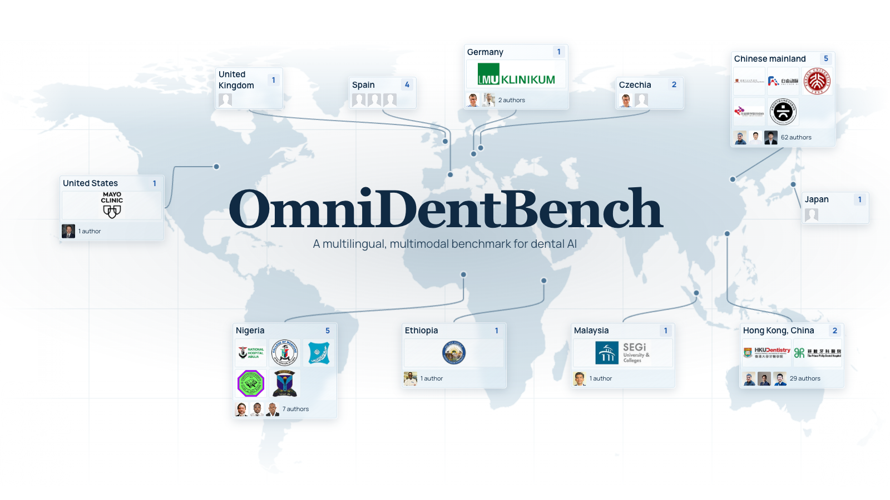](https://freedomintelligence.github.io/OmniDentBench/#collaboration-map)

**Try reading a benchmark item.** In ODB-0777, the model sees a dental radiograph and names the root canal configuration. A judge compares its answer with the reference and awards 100 or 0. For an open-ended question, the judge scores each criterion in the item's weighted rubric. [Radiograph by Doumari et al., Fig. 2](https://doi.org/10.7759/cureus.86471) · [CC BY 4.0](https://creativecommons.org/licenses/by/4.0/)

| Question format | Items | Scoring |
| --- | ---: | --- |
| Exact answer | 605 | Objective accuracy |
| Multiple choice | 108 | Objective accuracy |
| Open-ended | 465 | Weighted item-specific rubrics with safety red flags |

## Quick start

Install with **Python 3.10+**. Run the commands from the repository root.

```bash
git clone --depth 1 https://github.com/FreedomIntelligence/OmniDentBench.git
cd OmniDentBench
python3 -m venv .venv
. .venv/bin/activate
python -m pip install -r requirements.txt
python -m unittest discover -s tests -v
```

Copy [`.env.example`](.env.example) to `.env`, set the base URLs and API keys for the model and judge, and load it. Both endpoints must support OpenAI-compatible Chat Completions with JSON output. The target model needs image input for multimodal items. Replace both model ID placeholders below.

```bash
cp .env.example .env
# Fill in the API bases and keys in .env before sourcing.
. ./.env
python -m evaluation --language en --model YOUR_MODEL_ID --judge YOUR_JUDGE_ID --limit 3 --output runs/smoke
```

Remove `--limit 3` to run the full selected language, or add `--text-only` to evaluate the 79 items without figures. Choose a fresh `--output` directory each time. See the [evaluator guide](evaluation/README.md) for PowerShell setup, additional flags, and output files.

## Dataset and scoring

- **Items** are in [`data/<language>/items.json`](data). Files contain questions, answer options where applicable, references, scoring rubrics, and image references. Experts reviewed translations for a shared sample of 118 items.
- **Figures** ship with the repository. See the [figure manifest](data/figures.csv) and [source articles](data/sources.csv) for provenance and reuse terms.

<details>
<summary>Supported languages and CLI codes</summary>

| Language | Code | Language | Code |
| --- | --- | --- | --- |
| English | `en` | Simplified Chinese | `zh-CN` |
| Traditional Chinese (Hong Kong) | `zh-HK` | Spanish | `es` |
| French | `fr` | German | `de` |
| Japanese | `ja` | Modern Standard Arabic | `ar` |

</details>

### Interpretation and reproducibility

Report objective accuracy and the open-ended mean separately. A triggered safety red flag sets the open-ended item score to zero. When publishing results, include the language, item selection, denominators, model and judge IDs, and the exact tag or commit. [Scoring rules and failure handling](evaluation/README.md#scoring-and-failure-handling)

## Institutions and team

OmniDentBench brings together **105 team members** and **16 partner institutions**. [Explore the collaboration map](https://freedomintelligence.github.io/OmniDentBench/#collaboration-map)

### Steering chairs (3)

<table>
  <tr>
    <td align="center" width="88"><a href="https://freedomintelligence.github.io/OmniDentBench/#member-059-junwen-wang"><br><sub>Junwen Wang</sub></a></td>
    <td align="center" width="88"><a href="https://freedomintelligence.github.io/OmniDentBench/#member-060-zuolin-jin"><br><sub>Zuolin Jin</sub></a></td>
    <td align="center" width="88"><a href="https://freedomintelligence.github.io/OmniDentBench/#member-061-benyou-wang">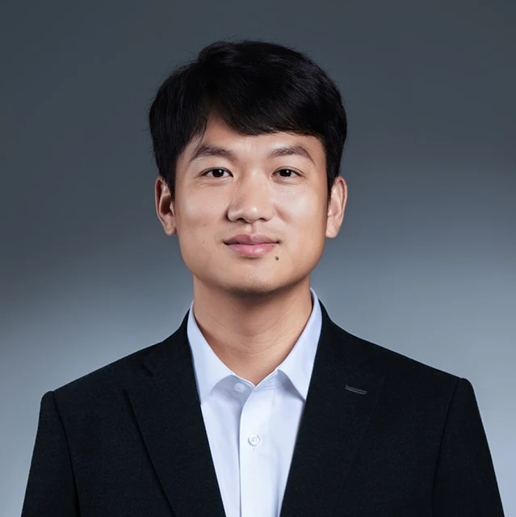<br><sub>Benyou Wang</sub></a></td>
  </tr>
</table>

### Steering committee members (13)

<table>
  <tr>
    <td align="center" width="88"><a href="https://freedomintelligence.github.io/OmniDentBench/#member-063-walter-yu-hang-lam"><br><sub>Walter Yu Hang Lam</sub></a></td>
    <td align="center" width="88"><a href="https://freedomintelligence.github.io/OmniDentBench/#member-064-will-wei-qiao"><br><sub>Will Wei Qiao</sub></a></td>
    <td align="center" width="88"><a href="https://freedomintelligence.github.io/OmniDentBench/#member-065-john-adeoye"><br><sub>John Adeoye</sub></a></td>
    <td align="center" width="88"><a href="https://freedomintelligence.github.io/OmniDentBench/#member-066-shan-zhiyi">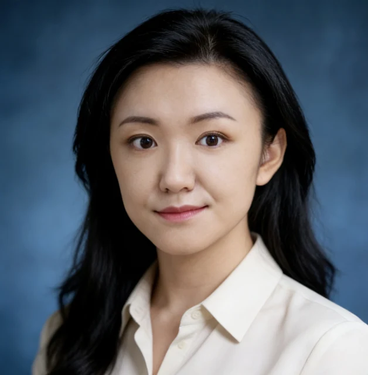<br><sub>Zhiyi Shan</sub></a></td>
    <td align="center" width="88"><a href="https://freedomintelligence.github.io/OmniDentBench/#member-067-teddy-weifa-yang"><br><sub>Wei-fa Yang</sub></a></td>
    <td align="center" width="88"><a href="https://freedomintelligence.github.io/OmniDentBench/#member-068-xin-li">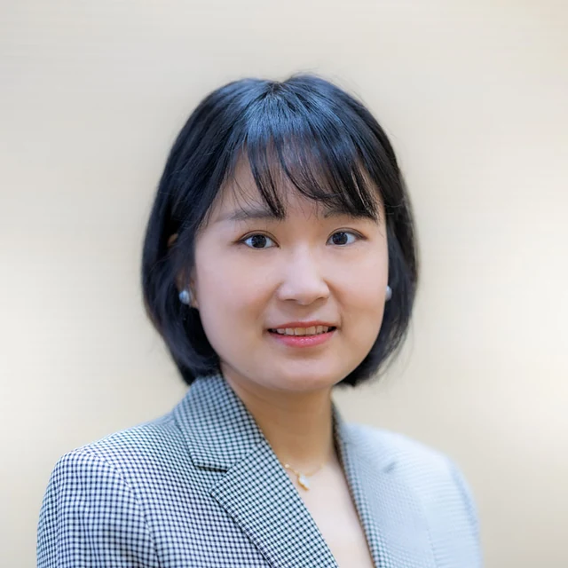<br><sub>Xin Li</sub></a></td>
    <td align="center" width="88"><a href="https://freedomintelligence.github.io/OmniDentBench/#member-069-zhongyuan-tang">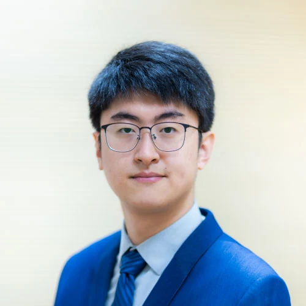<br><sub>Zhongyuan Tang</sub></a></td>
    <td align="center" width="88"><a href="https://freedomintelligence.github.io/OmniDentBench/#member-075-andrew-nalley"><br><sub>Andrew Nalley</sub></a></td>
  </tr>
  <tr>
    <td align="center" width="88"><a href="https://freedomintelligence.github.io/OmniDentBench/#member-076-george-pelekos">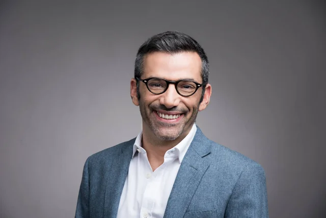<br><sub>George Pelekos</sub></a></td>
    <td align="center" width="88"><a href="https://freedomintelligence.github.io/OmniDentBench/#member-077-pradeep-singh"><br><sub>Pradeep Singh</sub></a></td>
    <td align="center" width="88"><a href="https://freedomintelligence.github.io/OmniDentBench/#member-062-liangyi-chen">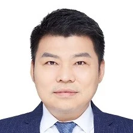<br><sub>Liangyi Chen</sub></a></td>
    <td align="center" width="88"><a href="https://freedomintelligence.github.io/OmniDentBench/#member-078-gloria-hai-ming-wong"><br><sub>Gloria Hai Ming Wong</sub></a></td>
    <td align="center" width="88"><a href="https://freedomintelligence.github.io/OmniDentBench/#member-079-lijian-jin"><br><sub>Lijian Jin</sub></a></td>
  </tr>
</table>

### Steering committee student members (8)

<table>
  <tr>
    <td align="center" width="88"><a href="https://freedomintelligence.github.io/OmniDentBench/#member-070-junjie-zhao">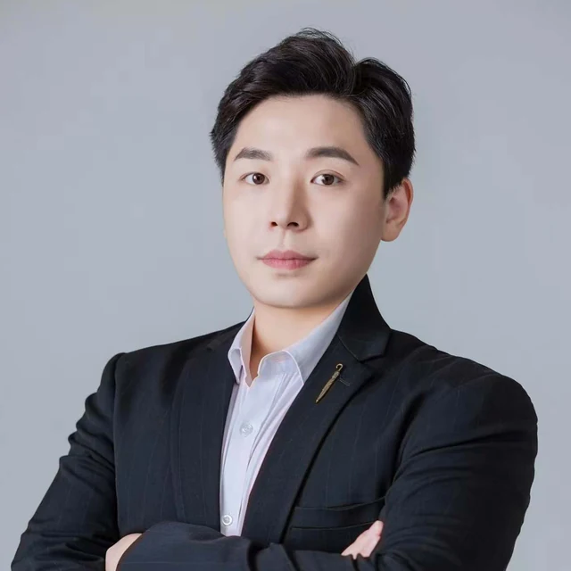<br><sub>Junjie Zhao</sub></a></td>
    <td align="center" width="88"><a href="https://freedomintelligence.github.io/OmniDentBench/#member-071-ziying-sheng">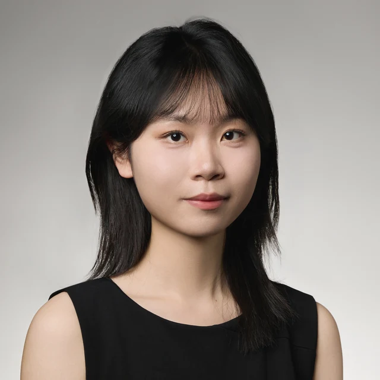<br><sub>Ziying Sheng</sub></a></td>
    <td align="center" width="88"><a href="https://freedomintelligence.github.io/OmniDentBench/#member-072-jiajun-you">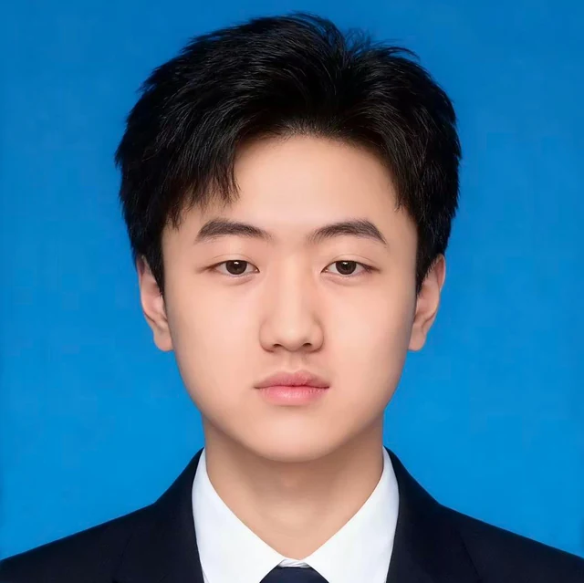<br><sub>Jiajun You</sub></a></td>
    <td align="center" width="88"><a href="https://freedomintelligence.github.io/OmniDentBench/#member-073-zhenyang-cai"><br><sub>Zhenyang Cai</sub></a></td>
    <td align="center" width="88"><a href="https://freedomintelligence.github.io/OmniDentBench/#member-074-zhou-su">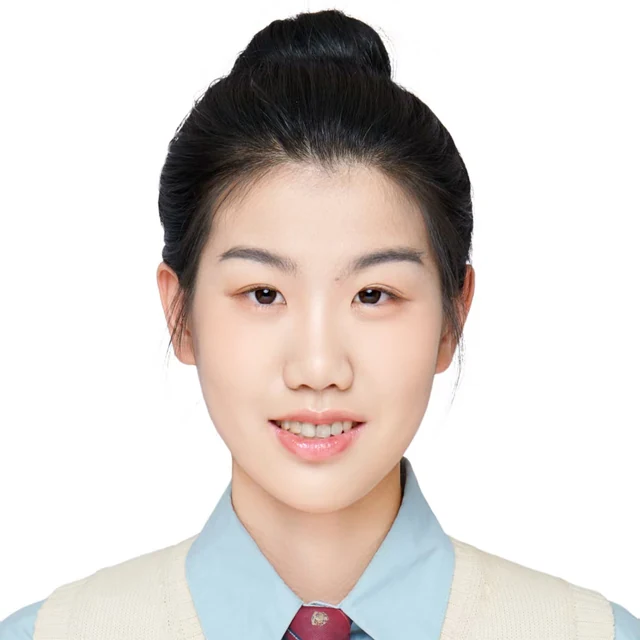<br><sub>Zhou Su</sub></a></td>
    <td align="center" width="88"><a href="https://freedomintelligence.github.io/OmniDentBench/#member-080-jingyi-liang"><br><sub>Jingyi Liang</sub></a></td>
    <td align="center" width="88"><a href="https://freedomintelligence.github.io/OmniDentBench/#member-081-zikun-jin"><br><sub>Zikun Jin</sub></a></td>
    <td align="center" width="88"><a href="https://freedomintelligence.github.io/OmniDentBench/#member-082-xiang-liu"><br><sub>Xiang Liu</sub></a></td>
  </tr>
</table>

### Specialty chairs (12)

<table>
  <tr>
    <td align="center" width="88"><a href="https://freedomintelligence.github.io/OmniDentBench/#member-001-ming-zhong"><br><sub>Ming Zhong</sub></a></td>
    <td align="center" width="88"><a href="https://freedomintelligence.github.io/OmniDentBench/#member-002-dayong-liu"><br><sub>Dayong Liu</sub></a></td>
    <td align="center" width="88"><a href="https://freedomintelligence.github.io/OmniDentBench/#member-003-hui-zhang"><br><sub>Hui Zhang</sub></a></td>
    <td align="center" width="88"><a href="https://freedomintelligence.github.io/OmniDentBench/#member-004-mingming-xu"><br><sub>Mingming Xu</sub></a></td>
    <td align="center" width="88"><a href="https://freedomintelligence.github.io/OmniDentBench/#member-005-qing-liu"><br><sub>Qing Liu</sub></a></td>
    <td align="center" width="88"><a href="https://freedomintelligence.github.io/OmniDentBench/#member-006-weihua-cai">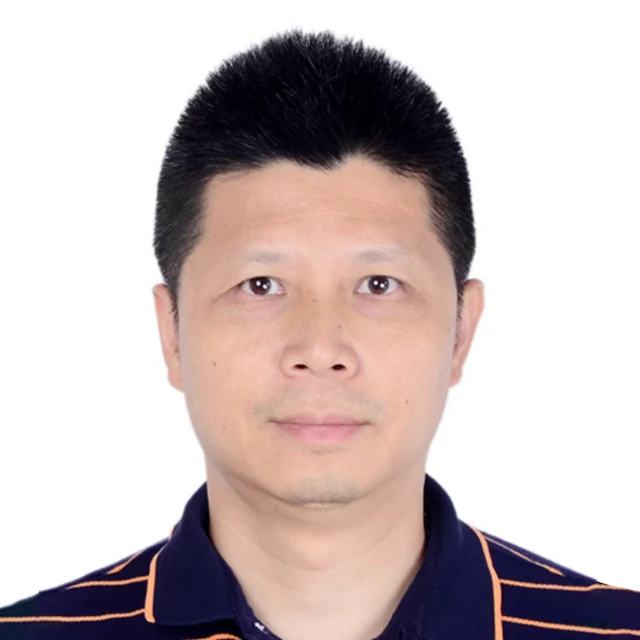<br><sub>Weihua Cai</sub></a></td>
    <td align="center" width="88"><a href="https://freedomintelligence.github.io/OmniDentBench/#member-007-xiaojing-wang"><br><sub>Xiaojing Wang</sub></a></td>
    <td align="center" width="88"><a href="https://freedomintelligence.github.io/OmniDentBench/#member-008-yanning-ma"><br><sub>Yanning Ma</sub></a></td>
  </tr>
  <tr>
    <td align="center" width="88"><a href="https://freedomintelligence.github.io/OmniDentBench/#member-009-shan-jiang"><br><sub>Shan Jiang</sub></a></td>
    <td align="center" width="88"><a href="https://freedomintelligence.github.io/OmniDentBench/#member-010-feng-wang">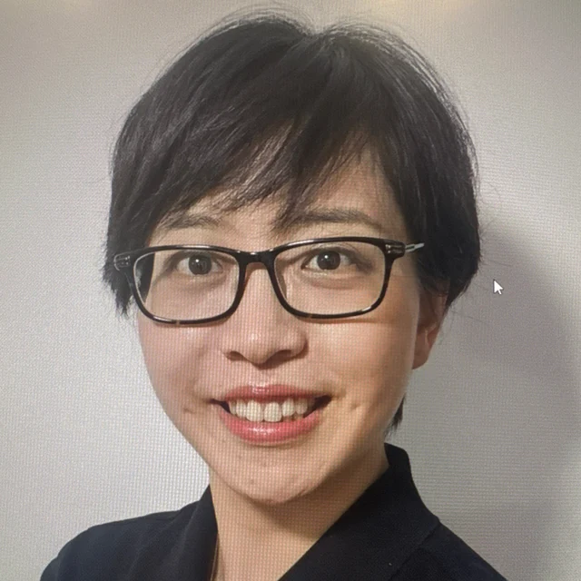<br><sub>Feng Wang</sub></a></td>
    <td align="center" width="88"><a href="https://freedomintelligence.github.io/OmniDentBench/#member-011-kun-qi"><br><sub>Kun Qi</sub></a></td>
    <td align="center" width="88"><a href="https://freedomintelligence.github.io/OmniDentBench/#member-012-yancheng-fang">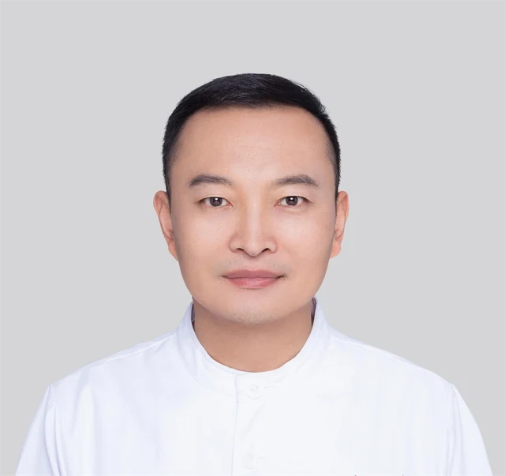<br><sub>Yancheng Fang</sub></a></td>
  </tr>
</table>

### Overseas experts (19)

<table>
  <tr>
    <td align="center" width="88"><a href="https://freedomintelligence.github.io/OmniDentBench/#member-085-abdul-warith-akinshipo"><br><sub>Abdul-Warith Akinshipo</sub></a></td>
    <td align="center" width="88"><a href="https://freedomintelligence.github.io/OmniDentBench/#member-086-abreham-ayele"><br><sub>Abreham Ayele</sub></a></td>
    <td align="center" width="88"><a href="https://freedomintelligence.github.io/OmniDentBench/#member-087-adetayo-aborisade"><br><sub>Adetayo Aborisade</sub></a></td>
    <td align="center" width="88"><a href="https://freedomintelligence.github.io/OmniDentBench/#member-088-antonin-tichy"><br><sub>Antonin Tichy</sub></a></td>
    <td align="center" width="88"><a href="https://freedomintelligence.github.io/OmniDentBench/#member-089-aylin-barthelme"><br><sub>Aylin Barthelmé</sub></a></td>
    <td align="center" width="88"><a href="https://freedomintelligence.github.io/OmniDentBench/#member-090-brandon-c-key"><br><sub>Brandon C. Key</sub></a></td>
    <td align="center" width="88"><a href="https://freedomintelligence.github.io/OmniDentBench/#member-091-chizoba-okolo"><br><sub>Chizoba Okolo</sub></a></td>
    <td align="center" width="88"><a href="https://freedomintelligence.github.io/OmniDentBench/#member-092-colman-mcgrath"><br><sub>Colman McGrath</sub></a></td>
  </tr>
  <tr>
    <td align="center" width="88"><a href="https://freedomintelligence.github.io/OmniDentBench/#member-093-edward-chin-man"><br><sub>Edward Chin Man</sub></a></td>
    <td align="center" width="88"><a href="https://freedomintelligence.github.io/OmniDentBench/#member-094-ekhosuehi-theophilus-agho"><br><sub>Ekhosuehi Theophilus Agho</sub></a></td>
    <td align="center" width="88"><a href="https://freedomintelligence.github.io/OmniDentBench/#member-095-elabbas-elhussain"><br><sub>Elabbas Elhussain</sub></a></td>
    <td align="center" width="88"><a href="https://freedomintelligence.github.io/OmniDentBench/#member-096-falk-schwendicke"><br><sub>Falk Schwendicke</sub></a></td>
    <td align="center" width="88"><a href="https://freedomintelligence.github.io/OmniDentBench/#member-097-ibrahim-kayode-suleiman"><br><sub>Ibrahim Kayode Suleiman</sub></a></td>
    <td align="center" width="88"><a href="https://freedomintelligence.github.io/OmniDentBench/#member-098-miguel-roig-cayon"><br><sub>Miguel Roig Cayón</sub></a></td>
    <td align="center" width="88"><a href="https://freedomintelligence.github.io/OmniDentBench/#member-099-nasir-bashir"><br><sub>Nasir Bashir</sub></a></td>
    <td align="center" width="88"><a href="https://freedomintelligence.github.io/OmniDentBench/#member-100-olabisi-hajarat-oderinu"><br><sub>Olabisi Hajarat Oderinu</sub></a></td>
  </tr>
  <tr>
    <td align="center" width="88"><a href="https://freedomintelligence.github.io/OmniDentBench/#member-101-ramat-oyebunmi-braimah"><br><sub>Ramat Oyebunmi Braimah</sub></a></td>
    <td align="center" width="88"><a href="https://freedomintelligence.github.io/OmniDentBench/#member-102-ricardo-palacios-banuelos"><br><sub>Ricardo Palacios-Bañuelos</sub></a></td>
    <td align="center" width="88"><a href="https://freedomintelligence.github.io/OmniDentBench/#member-103-suresh-kandagal-veerabhadrappa">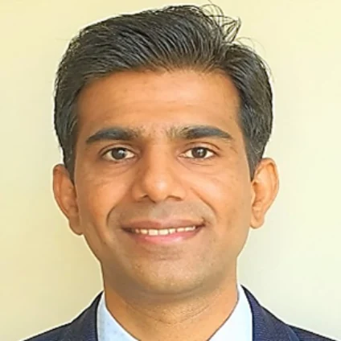<br><sub>Suresh Kandagal Veerabhadrappa</sub></a></td>
  </tr>
</table>

### ODB Consortium contributors (2)

<table>
  <tr>
    <td align="center" width="88"><a href="https://freedomintelligence.github.io/OmniDentBench/#member-104-xiangbo-wu"><br><sub>Xiangbo Wu</sub></a></td>
    <td align="center" width="88"><a href="https://freedomintelligence.github.io/OmniDentBench/#member-105-jianquan-li"><br><sub>Jianquan Li</sub></a></td>
  </tr>
</table>

### Specialty committee members (48)

<table>
  <tr>
    <td align="center" width="88"><a href="https://freedomintelligence.github.io/OmniDentBench/#member-053-yifan-zheng"><br><sub>Yifan Zheng</sub></a></td>
    <td align="center" width="88"><a href="https://freedomintelligence.github.io/OmniDentBench/#member-042-shuwei-huang">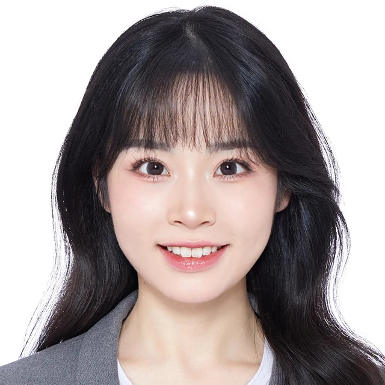<br><sub>Shuwei Huang</sub></a></td>
    <td align="center" width="88"><a href="https://freedomintelligence.github.io/OmniDentBench/#member-016-fangjie-zhou"><br><sub>Fangjie Zhou</sub></a></td>
    <td align="center" width="88"><a href="https://freedomintelligence.github.io/OmniDentBench/#member-048-xue-qiao"><br><sub>Xue Qiao</sub></a></td>
    <td align="center" width="88"><a href="https://freedomintelligence.github.io/OmniDentBench/#member-039-shiduo-sun">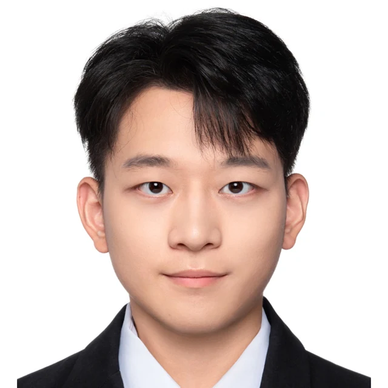<br><sub>Shiduo Sun</sub></a></td>
    <td align="center" width="88"><a href="https://freedomintelligence.github.io/OmniDentBench/#member-041-shixin-zhang">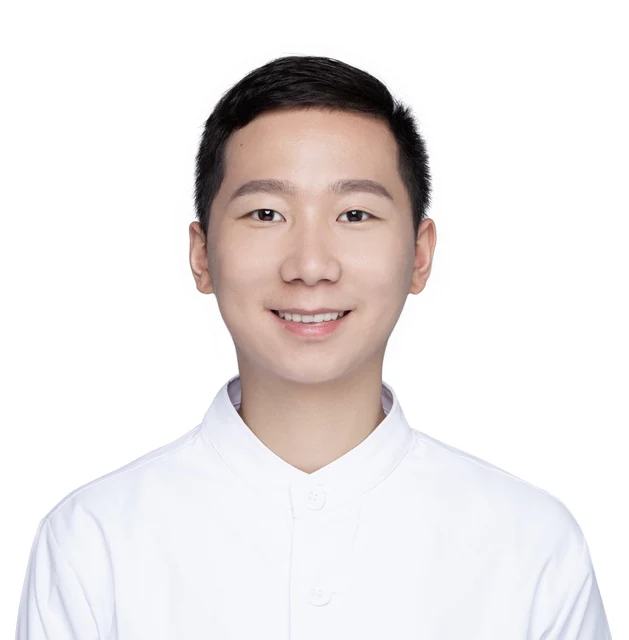<br><sub>Shixin Zhang</sub></a></td>
    <td align="center" width="88"><a href="https://freedomintelligence.github.io/OmniDentBench/#member-025-junting-wang">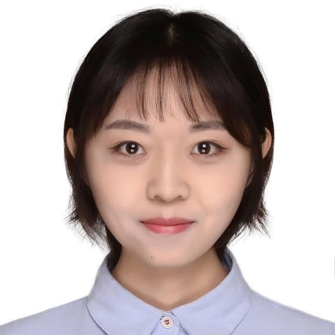<br><sub>Junting Wang</sub></a></td>
    <td align="center" width="88"><a href="https://freedomintelligence.github.io/OmniDentBench/#member-057-zhiqiang-deng">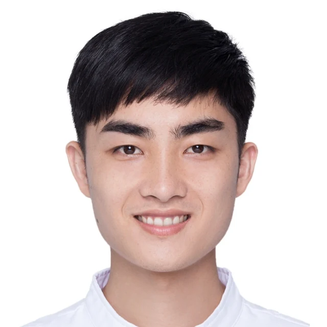<br><sub>Zhiqiang Deng</sub></a></td>
  </tr>
  <tr>
    <td align="center" width="88"><a href="https://freedomintelligence.github.io/OmniDentBench/#member-034-mingxin-zhang"><br><sub>Mingxin Zhang</sub></a></td>
    <td align="center" width="88"><a href="https://freedomintelligence.github.io/OmniDentBench/#member-024-jinyan-chen">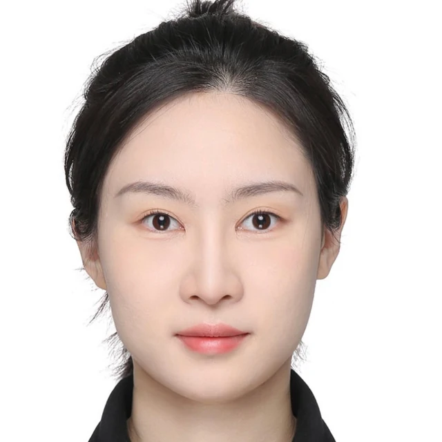<br><sub>Jinyan Chen</sub></a></td>
    <td align="center" width="88"><a href="https://freedomintelligence.github.io/OmniDentBench/#member-017-fen-liu">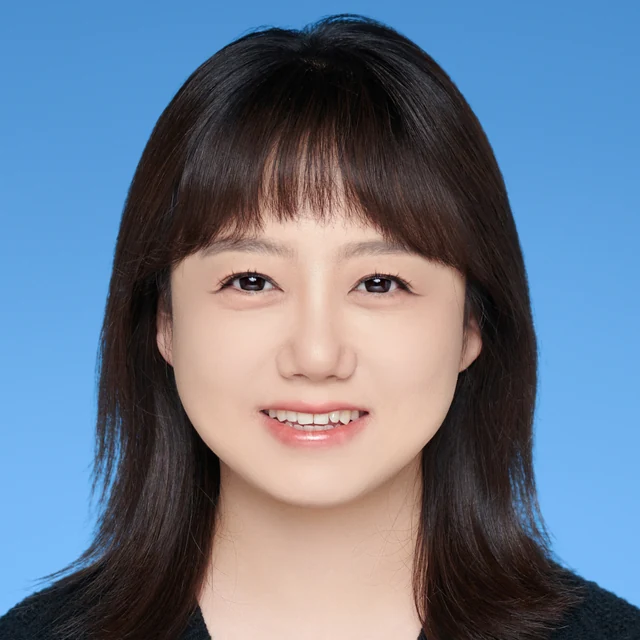<br><sub>Fen Liu</sub></a></td>
    <td align="center" width="88"><a href="https://freedomintelligence.github.io/OmniDentBench/#member-021-jiamin-zhao"><br><sub>Jiamin Zhao</sub></a></td>
    <td align="center" width="88"><a href="https://freedomintelligence.github.io/OmniDentBench/#member-022-jiaming-zhang">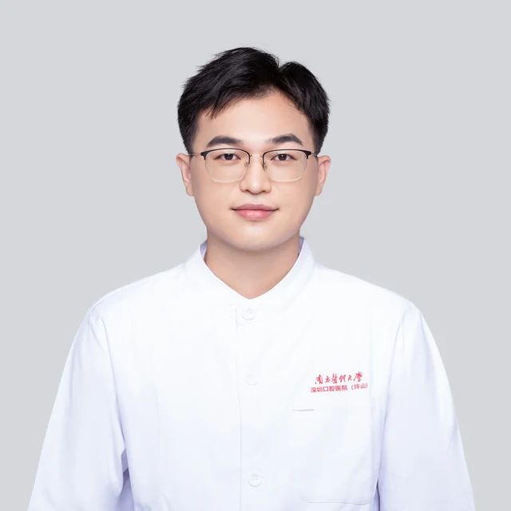<br><sub>Jiaming Zhang</sub></a></td>
    <td align="center" width="88"><a href="https://freedomintelligence.github.io/OmniDentBench/#member-030-menghong-li">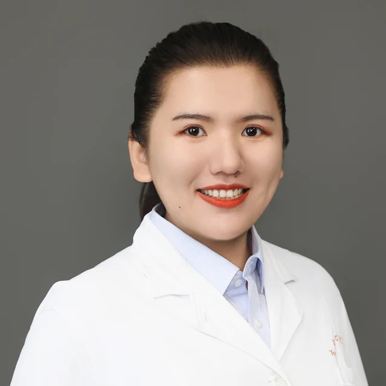<br><sub>Menghong Li</sub></a></td>
    <td align="center" width="88"><a href="https://freedomintelligence.github.io/OmniDentBench/#member-028-lin-zhao">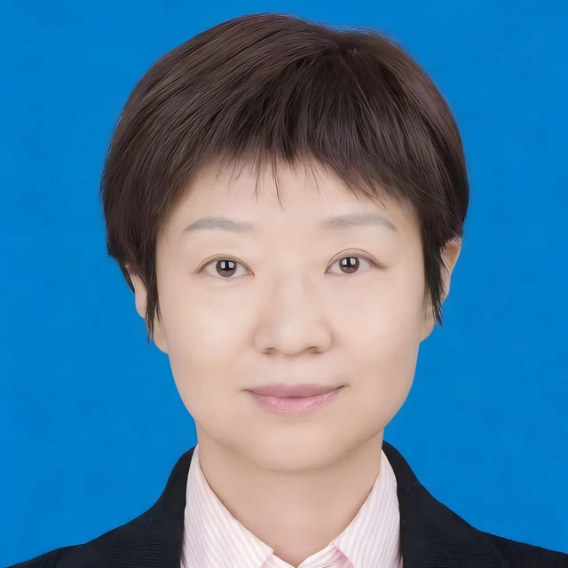<br><sub>Lin Zhao</sub></a></td>
    <td align="center" width="88"><a href="https://freedomintelligence.github.io/OmniDentBench/#member-040-shirong-he">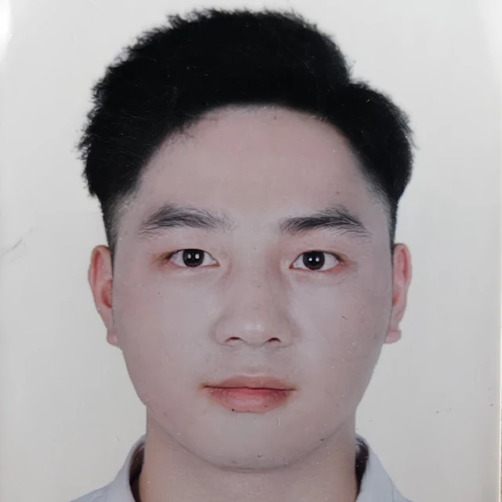<br><sub>Shirong He</sub></a></td>
  </tr>
  <tr>
    <td align="center" width="88"><a href="https://freedomintelligence.github.io/OmniDentBench/#member-052-yidan-guo">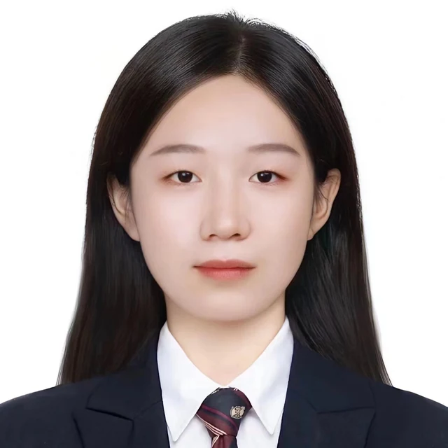<br><sub>Yidan Guo</sub></a></td>
    <td align="center" width="88"><a href="https://freedomintelligence.github.io/OmniDentBench/#member-033-minghui-wei">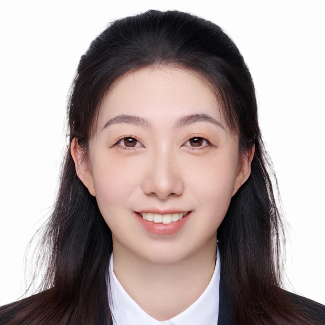<br><sub>Minghui Wei</sub></a></td>
    <td align="center" width="88"><a href="https://freedomintelligence.github.io/OmniDentBench/#member-056-zhenlai-zhu"><br><sub>Zhenlai Zhu</sub></a></td>
    <td align="center" width="88"><a href="https://freedomintelligence.github.io/OmniDentBench/#member-045-wu-songying"><br><sub>Songying Wu</sub></a></td>
    <td align="center" width="88"><a href="https://freedomintelligence.github.io/OmniDentBench/#member-054-ying-wang"><br><sub>Ying Wang</sub></a></td>
    <td align="center" width="88"><a href="https://freedomintelligence.github.io/OmniDentBench/#member-027-lei-shi"><br><sub>Lei Shi</sub></a></td>
    <td align="center" width="88"><a href="https://freedomintelligence.github.io/OmniDentBench/#member-044-tai-pak-chuen-patrick">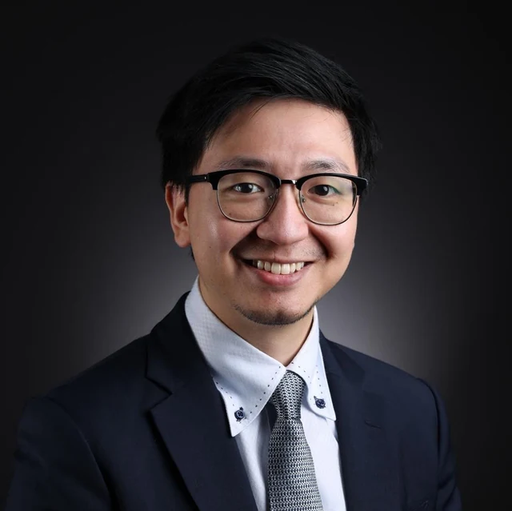<br><sub>Pak Chuen Patrick Tai</sub></a></td>
    <td align="center" width="88"><a href="https://freedomintelligence.github.io/OmniDentBench/#member-050-yaqiu-zhang"><br><sub>Yaqiu Zhang</sub></a></td>
  </tr>
  <tr>
    <td align="center" width="88"><a href="https://freedomintelligence.github.io/OmniDentBench/#member-037-peng-chen">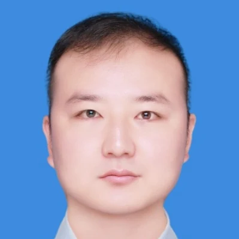<br><sub>Peng Chen</sub></a></td>
    <td align="center" width="88"><a href="https://freedomintelligence.github.io/OmniDentBench/#member-019-fujia-kang"><br><sub>Fujia Kang</sub></a></td>
    <td align="center" width="88"><a href="https://freedomintelligence.github.io/OmniDentBench/#member-032-min-huang"><br><sub>Min Huang</sub></a></td>
    <td align="center" width="88"><a href="https://freedomintelligence.github.io/OmniDentBench/#member-047-xiangjie-jin"><br><sub>Xiangjie Jin</sub></a></td>
    <td align="center" width="88"><a href="https://freedomintelligence.github.io/OmniDentBench/#member-015-dongfei-wang">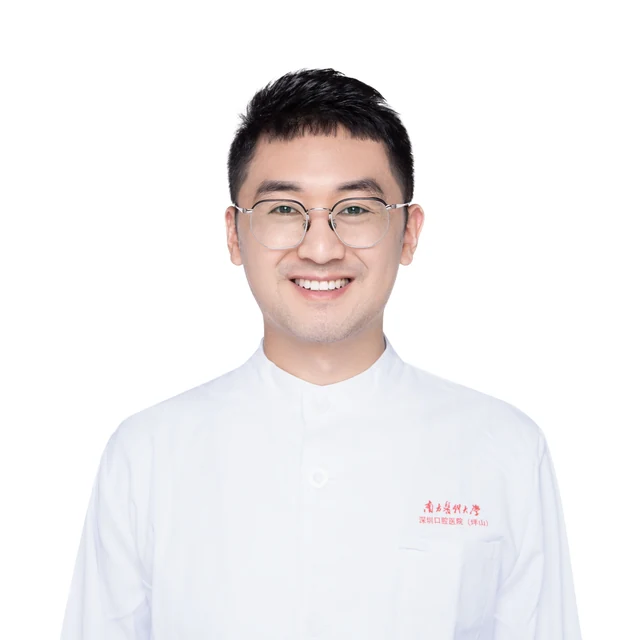<br><sub>Dongfei Wang</sub></a></td>
    <td align="center" width="88"><a href="https://freedomintelligence.github.io/OmniDentBench/#member-020-hao-chunxiu">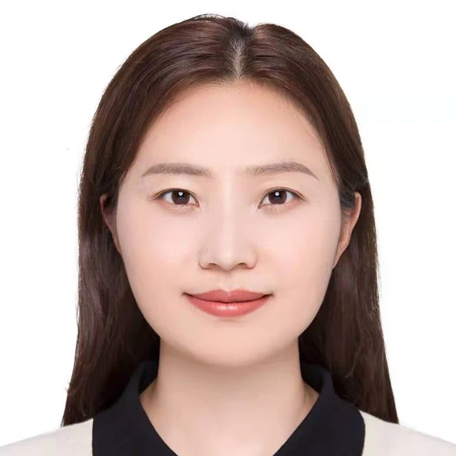<br><sub>Hao Chunxiu</sub></a></td>
    <td align="center" width="88"><a href="https://freedomintelligence.github.io/OmniDentBench/#member-043-siqi-qiu"><br><sub>Siqi Qiu</sub></a></td>
    <td align="center" width="88"><a href="https://freedomintelligence.github.io/OmniDentBench/#member-049-yang-jiang"><br><sub>Yang Jiang</sub></a></td>
  </tr>
  <tr>
    <td align="center" width="88"><a href="https://freedomintelligence.github.io/OmniDentBench/#member-036-peijuan-wang">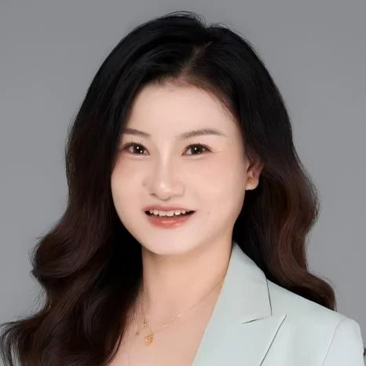<br><sub>Peijuan Wang</sub></a></td>
    <td align="center" width="88"><a href="https://freedomintelligence.github.io/OmniDentBench/#member-031-mengmeng-song">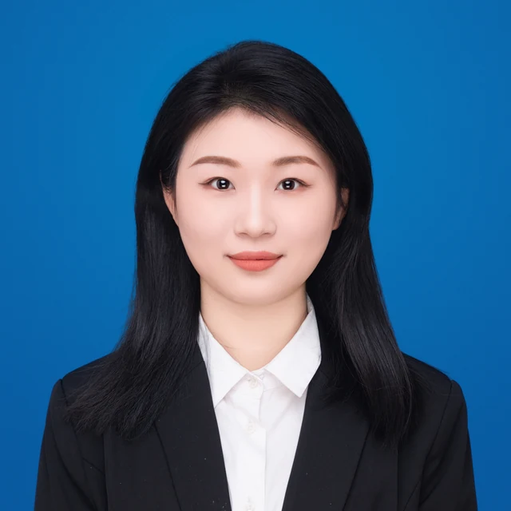<br><sub>Mengmeng Song</sub></a></td>
    <td align="center" width="88"><a href="https://freedomintelligence.github.io/OmniDentBench/#member-026-kuan-yang"><br><sub>Kuan Yang</sub></a></td>
    <td align="center" width="88"><a href="https://freedomintelligence.github.io/OmniDentBench/#member-058-zhuoying-li"><br><sub>Zhuoying Li</sub></a></td>
    <td align="center" width="88"><a href="https://freedomintelligence.github.io/OmniDentBench/#member-083-jian-jiao"><br><sub>Jian Jiao</sub></a></td>
    <td align="center" width="88"><a href="https://freedomintelligence.github.io/OmniDentBench/#member-084-wanjing-huang">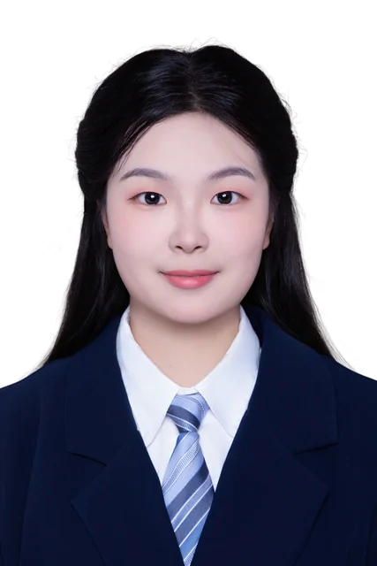<br><sub>Wanjing Huang</sub></a></td>
    <td align="center" width="88"><a href="https://freedomintelligence.github.io/OmniDentBench/#member-055-yujia-wu"><br><sub>Yujia Wu</sub></a></td>
    <td align="center" width="88"><a href="https://freedomintelligence.github.io/OmniDentBench/#member-014-daheng-li"><br><sub>Daheng Li</sub></a></td>
  </tr>
  <tr>
    <td align="center" width="88"><a href="https://freedomintelligence.github.io/OmniDentBench/#member-023-jinwen-liu">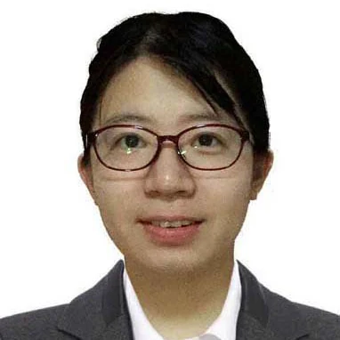<br><sub>Jinwen Liu</sub></a></td>
    <td align="center" width="88"><a href="https://freedomintelligence.github.io/OmniDentBench/#member-038-rui-lu"><br><sub>Rui Lu</sub></a></td>
    <td align="center" width="88"><a href="https://freedomintelligence.github.io/OmniDentBench/#member-013-bing-liu"><br><sub>Bing Liu</sub></a></td>
    <td align="center" width="88"><a href="https://freedomintelligence.github.io/OmniDentBench/#member-018-forest-cheng"><br><sub>Nam Forest Cheng</sub></a></td>
    <td align="center" width="88"><a href="https://freedomintelligence.github.io/OmniDentBench/#member-029-mao-yilin">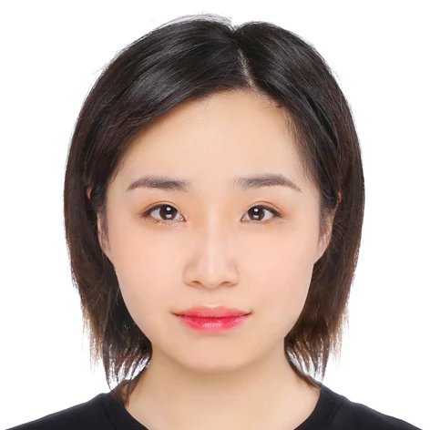<br><sub>Yilin Mao</sub></a></td>
    <td align="center" width="88"><a href="https://freedomintelligence.github.io/OmniDentBench/#member-035-patricia-ho"><br><sub>Patricia Ho</sub></a></td>
    <td align="center" width="88"><a href="https://freedomintelligence.github.io/OmniDentBench/#member-046-xu-leyao">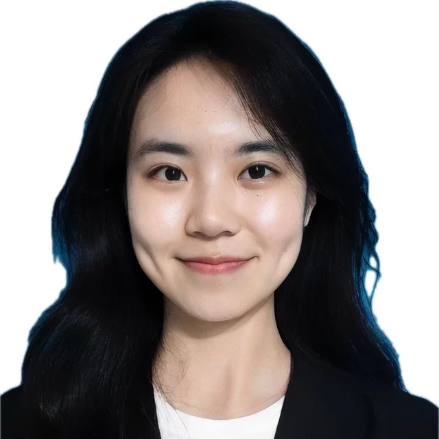<br><sub>XU Leyao</sub></a></td>
    <td align="center" width="88"><a href="https://freedomintelligence.github.io/OmniDentBench/#member-051-yefeng-wu"><br><sub>Yefeng Wu</sub></a></td>
  </tr>
</table>

### Cat members (2)

<table>
  <tr>
    <td align="center" width="88"><a href="https://freedomintelligence.github.io/OmniDentBench/#member-baize"><br><sub>Baize</sub></a></td>
    <td align="center" width="88"><a href="https://freedomintelligence.github.io/OmniDentBench/#member-paopao"><br><sub>Paopao</sub></a></td>
  </tr>
</table>

### Partner institutions

<table>
  <tr>
    <td align="center" width="25%"></td>
    <td align="center" width="25%"></td>
    <td align="center" width="25%"></td>
    <td align="center" width="25%"></td>
  </tr>
  <tr>
    <td align="center" width="25%"></td>
    <td align="center" width="25%"></td>
    <td align="center" width="25%"></td>
    <td align="center" width="25%"></td>
  </tr>
  <tr>
    <td align="center" width="25%"></td>
    <td align="center" width="25%"></td>
    <td align="center" width="25%"></td>
    <td align="center" width="25%"></td>
  </tr>
  <tr>
    <td align="center" width="25%"></td>
    <td align="center" width="25%"></td>
    <td align="center" width="25%"></td>
    <td align="center" width="25%"></td>
  </tr>
</table>

## Repository map

| Path | Contents |
| --- | --- |
| [`data/`](data) | Benchmark items, shared figures, and source manifests |
| [`evaluation/`](evaluation) | Python CLI, API client, prompts, and scoring |
| [`tests/`](tests) | Offline evaluator tests |
| [`docs/`](docs) | Bilingual GitHub Pages site and project assets |

To preview the site locally, run `python -m http.server --directory docs 8000` and open `http://localhost:8000`. GitHub Pages publishes from `main:/docs`. The [showcase data](docs/assets/showcase-data.js) contains the bilingual names, photos, and specialty counts. The [page script](docs/assets/flagship.js) and [stylesheet](docs/assets/flagship.css) control the layout.

## Contact & Data Access
If you have any questions or are interested in collaborating, feel free to reach out via: 📧 junjiezhao@connect.hku.hk or ziiyingsheng@gmail.com


## Citation and licensing

Cite *OmniDentBench (ODB)* with the [benchmark release](https://github.com/FreedomIntelligence/OmniDentBench/releases/tag/v1.0.0) or the exact Git commit used. The [MIT License](LICENSE) covers evaluator code. [CC BY 4.0](data/LICENSE) covers original benchmark content for which contributors hold licensing rights. Third-party figures and source materials retain their applicable terms. Consult the figure manifest and original articles for reuse and credit requirements.

If this benchmark is useful in your work, [star OmniDentBench](https://github.com/FreedomIntelligence/OmniDentBench) to follow the project. For data, evaluation, or reproducibility questions, [open an issue](https://github.com/FreedomIntelligence/OmniDentBench/issues).
